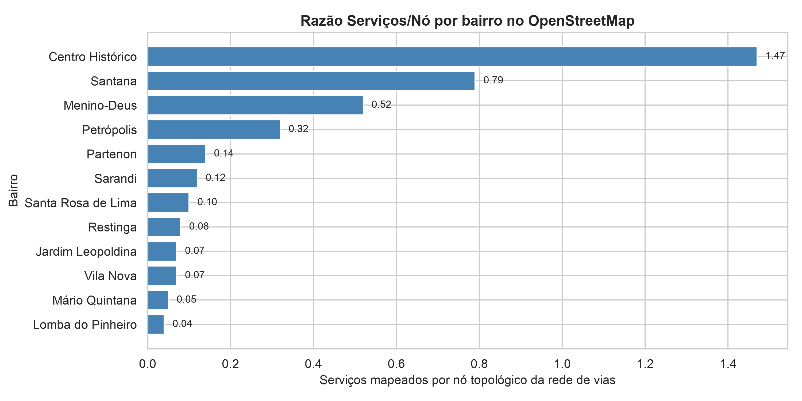

# GEO-Equidade

Metodologia aberta de auditoria territorial em dados geoespaciais abertos, com um estudo-piloto em 12 bairros de Porto Alegre (RS).

> **English summary.** GEO-Equidade is an open, exploratory methodology for auditing how evenly open geospatial data (OpenStreetMap) represents services across urban territories, before that data feeds public risk-response systems. The pilot covers 12 neighborhoods of Porto Alegre, Brazil, using one indicator: the **Services/Node Ratio** (mapped service features per topological node of the road network). In this sample the ratio ranges from 0.04 to 1.47. The indicator flags territories for data validation; it does **not** measure real service supply, estimate OSM completeness, or establish causal links to income, race/color, or public-system performance. Code is MIT, data is ODbL. Documentation below is in Portuguese.

> **Leia primeiro:** o indicador não mede a oferta real de serviços, não estima a completude absoluta do OpenStreetMap e não estabelece relação causal com renda, raça/cor ou desempenho de sistemas públicos. Ele sinaliza territórios que devem passar por validação, atualização ou complementação de dados antes de alimentarem sistemas públicos de priorização, alerta, roteamento ou resposta a riscos.

## Principais achados

Razão Serviços/Nó por bairro (extrato e execução documentados neste repositório):

| Bairro | Macrozona* | Nós (vias) | Serviços | Razão Serviços/Nó |
|---|---|---:|---:|---:|
| Centro Histórico | Centro | 980 | 1.440 | 1,47 |
| Santana | Centro | 381 | 301 | 0,79 |
| Menino-Deus | Centro | 772 | 400 | 0,52 |
| Petrópolis | Zona Leste | 644 | 206 | 0,32 |
| Partenon | Zona Leste | 1.629 | 235 | 0,14 |
| Sarandi | Zona Norte | 2.159 | 262 | 0,12 |
| Santa Rosa de Lima | Zona Sul | 1.078 | 107 | 0,10 |
| Restinga | Zona Sul | 2.353 | 179 | 0,08 |
| Vila Nova | Zona Sul | 1.389 | 102 | 0,07 |
| Jardim Leopoldina | Zona Norte | 361 | 26 | 0,07 |
| Mário Quintana | Zona Norte | 1.583 | 84 | 0,05 |
| Lomba do Pinheiro | Zona Leste | 2.039 | 85 | 0,04 |

\*Macrozona é classificação analítica própria do estudo, não regionalização oficial.



O que os números mostram, e só isso:

- A razão varia de **0,04** (Lomba do Pinheiro) a **1,47** (Centro Histórico). A mediana da amostra é **0,11**.
- **Centro Histórico** é o único bairro acima de 1,0: 1.440 feições de serviço para 980 nós de via. **Lomba do Pinheiro** tem 85 feições para 2.039 nós.
- Os três bairros da macrozona Centro são os três de maior razão da amostra (1,47; 0,79; 0,52). Fora dela, o maior valor é 0,32 (Petrópolis) e nove dos doze bairros ficam em 0,32 ou menos.

Esses valores descrevem **feições mapeadas no OSM** em um extrato específico. Uma razão baixa significa menos serviços mapeados por nó de via, e não menos serviços existentes. O resultado é um sinal para validação de dados, não uma conclusão sobre desigualdade de acesso.

## Problema público

Sistemas públicos de resposta a risco dependem cada vez mais de dados geoespaciais abertos. A abertura de uma base não garante, porém, que ela represente serviços e referências urbanas de modo equilibrado entre territórios. GEO-Equidade audita essa suposição antes que ela seja incorporada silenciosamente a decisões automatizadas.

## Metodologia

A descrição completa e executável está em [`notebooks/GEO_Equidade_Porto_Alegre.ipynb`](notebooks/GEO_Equidade_Porto_Alegre.ipynb). Resumo:

- **Indicador central:** Razão Serviços/Nó = feições classificadas como serviços ÷ nós topológicos da rede de vias.
- **Serviços (numerador):** feições do OSM com as tags `amenity`, `shop`, `healthcare`, `office`, `tourism` e `leisure`.
- **Nós (denominador):** nós da rede de vias com grau diferente de 2, extraídos com `pyrosm`. A rede não corresponde apenas a vias motorizadas.
- **Seleção da amostra:** união dos 10 bairros de maior população e dos 10 de maior densidade; em seguida, os 3 de maior população em cada uma de 4 macrozonas analíticas (Centro, Zona Norte, Zona Sul, Zona Leste), totalizando 12 bairros.
- **Falhas:** bairros com falha de geocodificação ou processamento são registrados em tabela de auditoria (`notebooks/auditoria_coleta_bairros_poa.csv`), nunca preenchidos por estimativa.

## Fontes de dados

| Fonte | Uso no projeto | Catalogado em dados.gov.br |
|---|---|---|
| OpenStreetMap (extrato Geofabrik, ODbL) | Rede de vias e feições classificadas como serviços — insumo do indicador central | Não |
| IBGE/SIDRA | População por bairro, usada na seleção da amostra | Não |
| Malha geométrica dos municípios brasileiros (IBGE) | Delimitação e conferência do recorte municipal de Porto Alegre (código IBGE 4314902) | **Sim** — [conjunto de dados](https://dados.gov.br/dados/conjuntos-dados/malha-geometrica-dos-municipios-brasileiros) |

Os polígonos de bairro vêm do Nominatim/OSM e não substituem necessariamente limites administrativos oficiais.

## Estrutura do repositório

```
data/        resultados consolidados do piloto e atribuição dos dados
docs/        dicionário de dados
notebooks/   notebook do estudo e tabela de auditoria de coleta
outputs/     gráfico da Razão Serviços/Nó
```

## Como reproduzir

Requisitos: Python 3 (a versão usada na execução original não foi registrada), cerca de 2 GB livres para o extrato do Brasil e memória compatível com o processamento de arquivos PBF.

1. Clone o repositório e instale as dependências: `pip install -r requirements.txt`.
2. Execute o notebook em `notebooks/` na ordem das seções. Ele baixa o extrato `brazil-latest.osm.pbf` da Geofabrik (cerca de 2 GB, uma única vez) e o recorta localmente para Porto Alegre por bounding box.
3. **Registre a data do download do extrato** e, se possível, o checksum do arquivo. Sem isso, o resultado não pode ser comparado a outras execuções.
4. Revise a tabela de falhas antes de interpretar os resultados.
5. Os resultados ficam em `data/resultados_piloto_porto_alegre.csv`; as colunas estão descritas em `docs/dicionario_de_dados.md`.

## Reprodutibilidade e versionamento dos dados

O OpenStreetMap é uma base colaborativa e atualizada continuamente. Por isso, extratos obtidos em datas diferentes produzem contagens diferentes, mesmo com os mesmos filtros e procedimentos.

- **Data do extrato usado:** não foi registrada com carimbo de data e hora no momento da coleta original. O arquivo veio da distribuição diária da Geofabrik. Este é o principal limite de reprodutibilidade do piloto.
- **Diferença entre execuções:** em uma comparação com uma execução anterior do mesmo pipeline, as contagens de serviços mudaram em 5 dos 12 bairros (Centro Histórico, Santana, Menino-Deus, Jardim Leopoldina e Partenon). Nos outros 7 (Petrópolis, Sarandi, Santa Rosa de Lima, Restinga, Vila Nova, Mário Quintana e Lomba do Pinheiro) os valores foram idênticos. **A magnitude das diferenças não foi registrada.**
- **Padrão observado:** três dos cinco bairros que mudaram são os três de maior razão da amostra, o que é compatível com a hipótese de edição mais ativa nas áreas centrais entre extrações. Os outros dois (Partenon e Jardim Leopoldina) não são centrais, então o padrão não é limpo. A hipótese **não foi testada**; a comparação com o histórico de edições do OSM é uma etapa futura.
- **Diferenças em relação ao artigo:** algumas contagens também diferem da tabela do artigo de referência. As diferenças não foram corrigidas manualmente.

A tabela e o gráfico deste repositório correspondem exclusivamente ao extrato e à execução aqui documentados. Não os compare como se fossem uma base estática.

## Limitações

- Amostra intencional (N=12), não representativa estatisticamente dos bairros de Porto Alegre.
- Macrozonas são classificação analítica própria; simplificam heterogeneidades internas e não definem periferia, centralidade ou vulnerabilidade.
- A unidade bairro agrega diferenças internas.
- Nós e serviços derivam do OSM; não são observações independentes da infraestrutura ou dos serviços reais.
- A categoria "serviços" depende das tags escolhidas e não equivale ao universo de serviços existentes. Duplicidades semânticas e ausência de registros afetam a contagem.
- Os resultados dependem dos limites de bairro (Nominatim), do recorte espacial e da definição operacional de nós.
- O indicador não mede oferta real de serviços, completude absoluta do OSM nem causalidade.

## Referência

*Quem não está no mapa, não está no algoritmo: sub-representação em dados geoespaciais abertos e implicações para sistemas de resposta a risco em Porto Alegre.* Artigo submetido ao Boletim de Políticas Públicas (EACH-USP × Instituto da Hora).

## Licença e atribuição

Código sob licença MIT (ver [`LICENSE`](LICENSE)). Dados do OpenStreetMap © contribuidores do OpenStreetMap, sob Open Database License (ODbL); extrato distribuído pela Geofabrik. A atribuição completa está em [`data/README.md`](data/README.md).

## Autoria

Helena de Oliveira Valanera, 2026.
